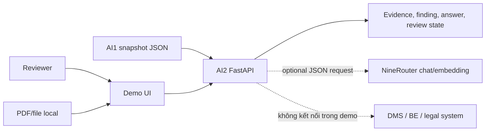
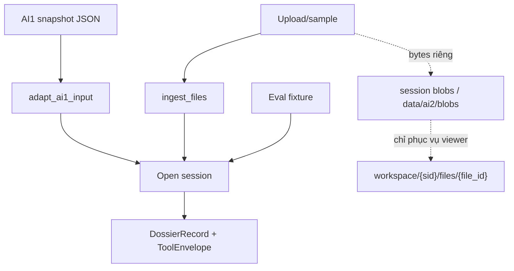
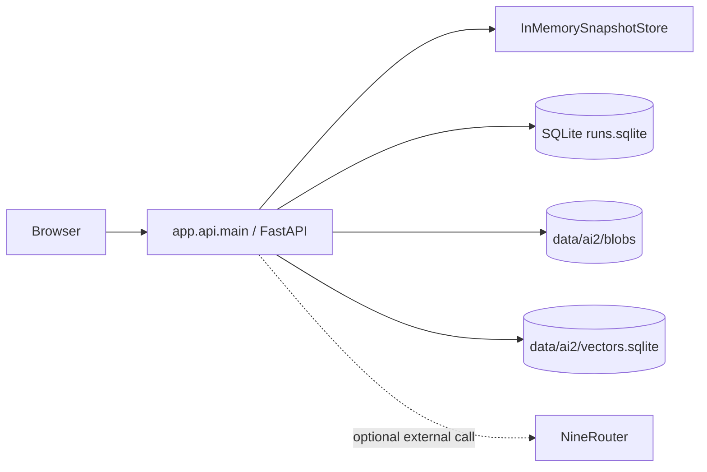
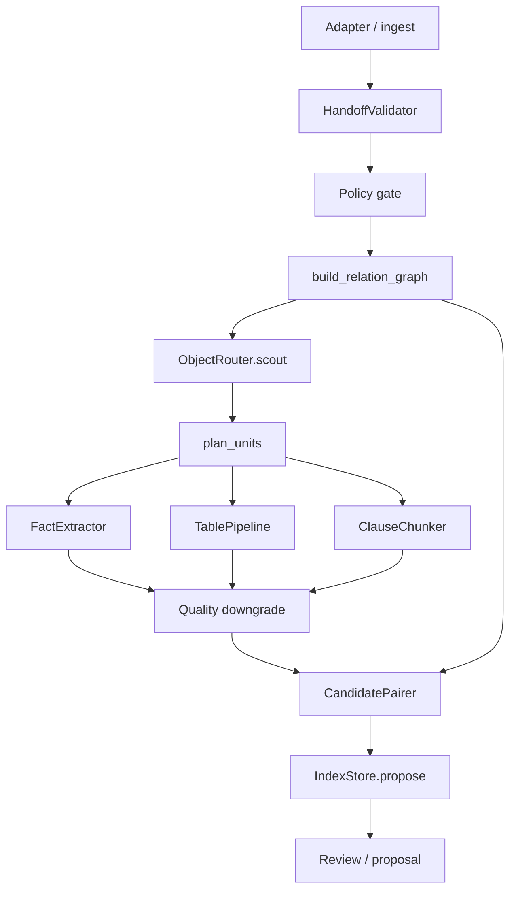
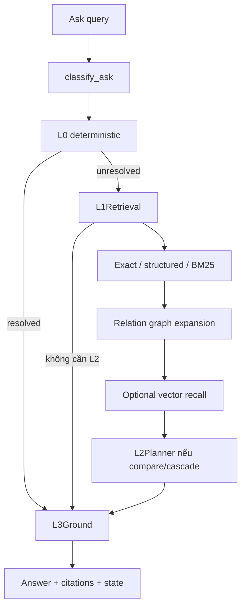
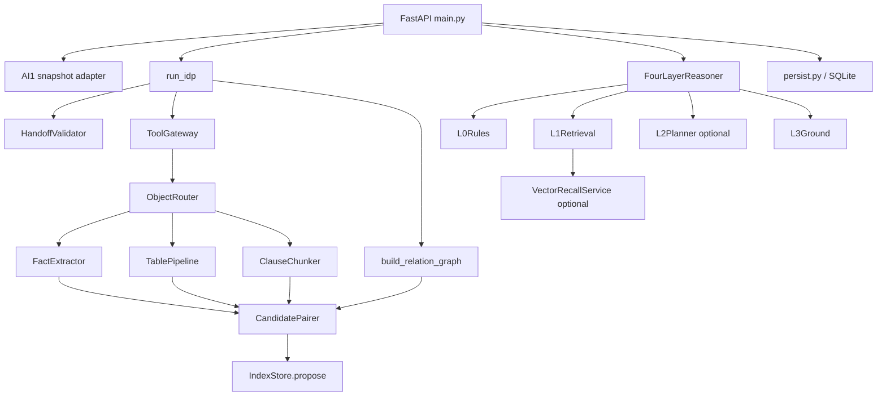
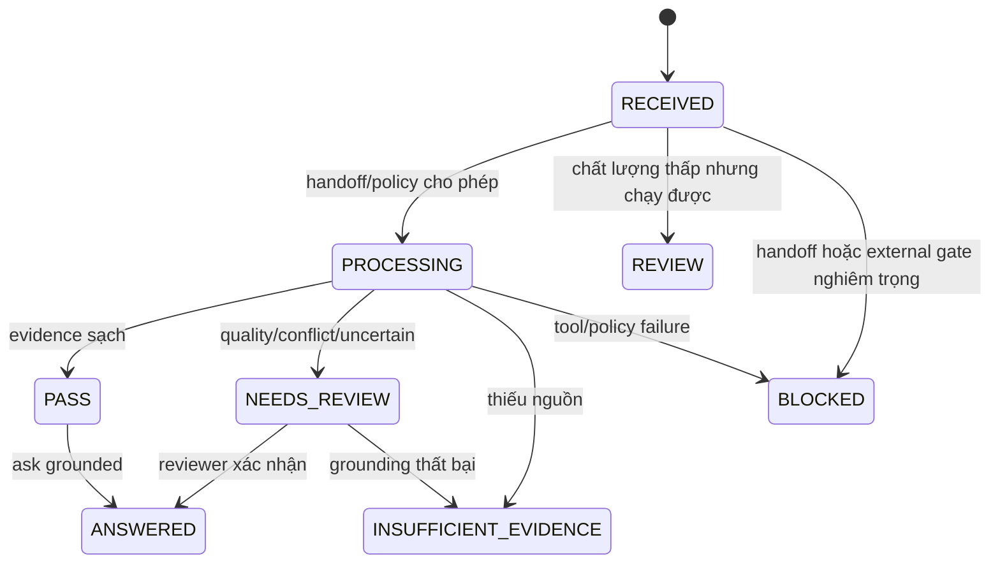

# AI2-DOC-04 — Architecture AI2: workspace/demo components và processing boundary

**Phiên bản:** v2.1
**Ngày:** 23/10/2026
**Trạng thái:** Current workspace/demo implementation description (consolidated)
**Phạm vi:** Các component AI2 workspace/demo trong `ai-service` chạy local bằng FastAPI/Uvicorn, gồm `app.api`, `run_idp`, `FourLayerReasoner`, SQLite/in-memory store và boundary `POST /jobs/idp`. Tài liệu **không** mô tả full product: PostgreSQL job store, Backend `/jobs` orchestration, ACL/durable read model và production deployment nằm ở [DOC-04 sản phẩm](../DOC-04-architecture.md), [contract Backend → AI2](../contracts/BE-AI2-PROCESSING-CONTRACT.vi.md) và [backend README](../../backend/README.md).

Đây là architecture description của các component workspace/demo đang chạy local, không phải full product hay production target. Phương pháp tổ chức view xem tại [AI2-architecture-method](AI2-architecture-method.vi.md). Luồng từng bước input → xử lý → output → failure nằm ở [AI2-07](AI2-07-full-pipeline.vi.md); demo OCR/IDP tối giản standalone là một phần riêng ở [AI2-07 §F](AI2-07-full-pipeline.vi.md#f-demo-ocridp-tối-giản-riêng), không phải pipeline `run_idp`/`FourLayerReasoner`.

Tài liệu này thay thế các bản AI2-05, AI2-08, AI2-09 và AI2-10 cũ; các bản đó đã được hợp nhất ở đây và trong AI2-07. Hai đề xuất cũ `ai-service/architecture.md` (v0.2) và `ai-service/docs/CONTRACT_INTELLIGENCE_ARCHITECTURE.md` (v0.1) cũng đã được thay thế; xem [§12](#12-lịch-sử-và-đề-xuất-đã-bị-thay-thế).

## 1. Phạm vi, stakeholder và nguyên tắc

| Stakeholder | Câu hỏi cần trả lời |
|---|---|
| Reviewer nghiệp vụ | Evidence nằm ở trang/node nào? Có thể kết luận hay cần review? |
| Product owner | Demo hỗ trợ những luồng nào và giới hạn ở đâu? |
| AI2 engineer | Input, pipeline, relation graph, retrieval và grounding nối với nhau thế nào? |
| Operator | LLM/embedding có được gọi không? Vì sao bị `BLOCKED`, `REVIEW` hoặc `INSUFFICIENT_EVIDENCE`? |

Nguyên tắc an toàn:

- AI1 snapshot JSON là nguồn dữ liệu OCR/structure chính của AI2.
- `pdf_bytes` chỉ là blob riêng để viewer mở file trong demo; không đi vào `DossierRecord`, retrieval hoặc prompt.
- Text trong tài liệu là dữ liệu không tin cậy; prompt injection không phải instruction.
- LLM không phải nguồn sự thật và không được tự tạo citation.
- Vector embedding chỉ tìm candidate ở lớp recall; mọi candidate phải qua filter và grounding.
- AI2 chỉ tạo `IndexContribution.publish = "propose"`; không tự đổi active index.

## 2. C0 — Context view



AI2 không phải DMS, hệ thống ký số hoặc hệ thống phán quyết pháp lý. AI2 chỉ đưa ra kết quả grounded/reviewable từ snapshot hiện tại.

## 3. C1 — Input boundary và entrypoint

Demo có các cách mở một workspace hoặc gửi dữ liệu:

| Entry | Route | Hành vi |
|---|---|---|
| Sample/upload | `POST /api/workspace/sample`, `/sample-compare`, `/upload` | Demo gọi `ingest_files`; AI1 giả nằm trong process, blob giữ riêng để viewer |
| AI1 thật | `POST /api/workspace/ai1-snapshot` | `adapt_ai1_input` nhận canonical v1; result envelope và legacy chỉ đi qua compatibility path riêng |
| Legacy result v0.1 | `POST /api/workspace/ai1-result` | Chỉ nhận `ai1.result.v0.1` (`machine/effective`); từ chối snapshot v1 và không phải payload thay thế cho `/jobs/idp` |
| Evaluation case | `POST /api/workspace/case/{case_id}` | Mở fixture kiểm thử bằng cùng workspace UI |
| Backend processing | `POST /jobs/idp` | Chỉ nhận `be.ai2.processing.request.v1` có chứa `ai1.snapshot.v1`; đường này không thay shape snapshot |

Một lane không được fallback hoặc tự chuyển đổi sang lane còn lại.



### 3.1. AI2 nhận gì

Snapshot v1 là document-level wire contract gồm root provenance/execution metadata và `pages[]` với lines, words, tables, geometry, quality, table coverage và warnings. `nodes`, `source_files`, profile, pins nội bộ và AI2 facts không nằm trong wire snapshot; dossier grouping/body-annex mapping chưa thuộc contract AI1–AI2 hiện tại. Schema và semantic validation là gate hiện tại; quarantine vận hành là future phase. `ai2.ocr_edge_cases.v1` không phải handoff payload.

### 3.2. Handoff canonical AI1 → AI2

Hợp đồng canonical là [AI1–AI2 contract](../contracts/AI1-AI2-CONTRACT.vi.md) và [schema `ai1.snapshot.v1`](../contracts/ai1.snapshot.v1.schema.json). Tài liệu này chỉ giữ các quy ước vận hành của AI2, không định nghĩa lại payload:

- Tầng vận chuyển chuyển nguyên payload; không sửa semantic và không đổi shape giữa các lane.
- AI2 giữ nguyên identity/evidence reference và raw text, line, word, table, bbox, quality, coverage, warning.
- `PARTIAL`, `UNKNOWN`, `UNAVAILABLE` và `FAILED` giữ nguyên semantics: evidence thiếu khác evidence phủ định, không nâng thành complete và không kết luận “không có dữ liệu”.
- Không đưa re-OCR vào contract hiện tại; không tự tạo word bbox, table cells hoặc geometry bị thiếu.
- `ai1.result.v0.1` chỉ đi qua compatibility endpoint `/api/workspace/ai1-result`; không thay thế snapshot v1. Xem [review thực nghiệm](../reviews/AI2-REVIEW-2026-09-22.vi.md).

### 3.3. AI2 không nhận gì

- Không đưa nguyên PDF hoặc `pdf_bytes` vào reasoning.
- Không dựng lại word geometry/table cells nếu AI1 không gửi.
- Không coi `tables: []` là “chắc chắn không có bảng” nếu `table_coverage` là `UNKNOWN`.

## 4. C2 — Runtime/deployment view



| Thành phần | Vai trò hiện tại |
|---|---|
| FastAPI/Uvicorn | API workspace, extraction, reasoning, ask, review, publish proposal |
| `InMemorySnapshotStore` | Store record để `ToolGateway` đọc trong process |
| SQLite `runs.sqlite` | Persistence của session, record, job, review và metadata blob |
| `data/ai2/blobs` | Lưu bytes upload riêng cho file viewer |
| SQLite vector index | Lưu evidence segment/vector theo snapshot digest, model, dimension |
| NineRouter | Chat LLM hoặc OpenAI-compatible embedding khi policy/flag cho phép |

Demo hiện chạy synchronous. `plan_units` tạo thứ tự bounded theo page/node để tránh prompt toàn dossier và chuẩn bị cho resume; đây chưa phải distributed worker/checkpoint system.

## 5. C3 — Functional/pipeline view



### 5.1. Extraction sequence

1. Validate policy, lifecycle, pins và handoff.
2. Dựng relation graph từ node, parent, source role và explicit references.
3. Scout outline trước khi lấy nội dung.
4. Chia processing units bounded.
5. Route node thành `FIELD`, `TABLE` hoặc `CLAUSE`.
6. Tạo fact/table rows/chunks có citation.
7. Hạ `review_state` nếu page/node quality không chắc chắn.
8. Pair body–annex theo context, không Cartesian product.
9. Tạo `IndexContribution` và lưu proposal.

### 5.2. Table semantics

- `NOT_PRESENT`: hợp đồng/phụ lục thực sự không có bảng; hợp lệ, không tạo lỗi.
- `DETECTED` nhưng thiếu table/cells: `TABLE_STRUCTURE_UNAVAILABLE`.
- `UNKNOWN`/`UNAVAILABLE`: text có thể chạy degraded, không kết luận về bảng.
- `FAILED`: giữ lỗi extraction; không kết luận là không có bảng.
- Không có cells/geometry: không dựng merged cells, bbox hoặc row structure giả.
- Missing, `-`, `N/A` không bị biến thành zero.

## 6. C3 — Question/reasoning view



### 6.1. L0

Xử lý deterministic cho lookup, field card, party/MST, clause rõ ràng, security/prompt injection, query quá rộng và một số not-comparable case. Nếu giải được thì chỉ đi qua L3 để xác nhận citation.

### 6.2. L1

Ưu tiên exact label, structured key và deterministic semantic/BM25. Với `compare`/`cascade`, L1 thêm ancestor, same-clause và relation graph neighbors. Kết quả tối đa được giới hạn trước khi đóng gói context.

### 6.3. Vector recall

Vector service chỉ được gọi khi request bật `use_vector` và task phù hợp. Segment khoảng 1.600 ký tự, overlap khoảng 200 ký tự; index SQLite lọc theo snapshot digest, model, dimension và metadata. Candidate bị loại nếu node failed, span không còn khớp hoặc citation không hợp lệ.

### 6.4. L2 và L3

- L2 chỉ dùng cho compare/cascade, query không quá rộng và khi LLM/policy cho phép.
- L2 dùng tool allowlist, giới hạn step/replan/context; không gửi full PDF.
- L3 kiểm tra node, page revision, text span, allowed outline, citation và forbidden claim.
- Không đủ evidence: `INSUFFICIENT_EVIDENCE`.
- Quan hệ mơ hồ/conflict: `NEEDS_REVIEW`.
- Policy external bị chặn: `BLOCKED`.

## 7. C4 — Code/component view

| Concern | Implementation hiện tại | Test/coverage |
|---|---|---|
| API/session | `app/api/main.py` | API/workspace tests |
| AI1 compatibility | `app/pipeline/ai1_snapshot_adapter.py` | snapshot adapter tests |
| Handoff | `app/pipeline/handoff.py` | handoff/API tests |
| Scout/routing | `app/pipeline/router.py`, `app/pipeline/outline.py`, `ToolGateway` | routing/full pytest |
| Extraction | `app/pipeline/idp.py`, `fact.py`, `table.py`, `clause.py` | full pytest/input coverage |
| Relation | `app/pipeline/structure.py`, `build_relation_graph` | relation/implicit tests |
| Pair/proposal | `app/pipeline/candidate.py`, `app/pipeline/index.py` | compare/EC tests |
| Reasoning | `app/reasoning/*` (`FourLayerReasoner`, `L0Rules`, `L1Retrieval`, `L2Planner`, `L3Ground`) | reasoning/hybrid/API tests |
| Vector | `app/reasoning/vector_recall.py`, `SQLiteVectorIndex` | hybrid retrieval/live smoke |
| Persistence | `app/tools/persist.py`, `DossierRecord`, `JobResult` | demo/API tests |

Không dùng các tên `QueryRouter`, `ReasoningOrchestrator` hoặc `ActiveIndex` như component đã tồn tại; đó chỉ là khái niệm cũ/target nếu xuất hiện trong tài liệu khác.

### 7.1. Component topology



Invariant chung:

- Mọi access vào snapshot trong pipeline/reasoning đi qua `ToolGateway`.
- Evidence phải giữ `node_id`, `page_revision_id`, `text_span` và snapshot digest khi có.
- Không component nào được biến LLM output thành fact authoritative nếu chưa qua grounding.
- `IndexStore.propose` không tự publish active index.

### 7.2. Component contracts

| Component | Contract và invariant |
|---|---|
| `HandoffValidator` | Input pages/nodes/tables/profile/pins/lifecycle; output `ValidatedHandoff`, issues và `blocked`. Block khi lifecycle không active, pin/schema nghiêm trọng, encrypted/failed handoff hoặc issue blocked. Review khi page LOW/EMPTY, node chưa confirmed, table coverage chưa chắc chắn. Không đọc raw PDF và không tự tạo geometry. |
| `ObjectRouter` / `ToolGateway` | Scout outline trước rồi route node thành `FIELD`, `TABLE`, `CLAUSE`. Gateway kiểm tra tenant/dossier, permission, lifecycle, pins và allowlist; cung cấp thao tác read-only/sandbox. Không gửi payload dossier-sized vào LLM. |
| `FactExtractor` | Giữ `raw_value`, tạo `normalized_value` và metadata subject/role/unit/scope/validity. Citation phải trỏ về node/page revision/text span. Fact trên page/node quality thấp bị hạ `NEEDS_REVIEW`. |
| `TablePipeline` | Chỉ xử lý table snapshot/cells AI1 cung cấp. Giữ sparse cell, missing, `-`, `N/A` khác zero. Không merge bảng chỉ vì cùng số cột. Thiếu cells/geometry thì tạo issue hoặc degraded result; không dựng bảng giả. |
| `ClauseChunker` | Cắt theo structural node, breadcrumb, page range, source block và continuation. Giữ raw label và parent relation. Boundary mơ hồ hoặc text không đủ citation → `NEEDS_REVIEW`. |
| `build_relation_graph` | Tạo node cho structural/source objects; edge `PARENT_OF`, `SAME_CLAUSE`, `REFERENCES`, `AMENDS`, `DEFINES`, `USES_DEFINED_TERM` khi có support. Edge có support `STRUCTURAL`, `EXPLICIT_TEXT` hoặc `HEURISTIC`, citation và source digest. Edge heuristic không được biến thành kết luận chắc chắn. |
| `CandidatePairer` | Pair body/annex theo subject, role, item key, unit, scope, validity và relation context. Phân biệt consistent, conflicting, incomplete, unclear. Không trả `LEGAL_WINNER` và không tự chọn điều khoản có hiệu lực pháp lý cao hơn. |
| `IndexStore` | Lưu fact/chunk/candidate/evidence issue/coverage thành contribution có extraction version và proposed index version. Không đổi active index pointer. |

### 7.3. `ToolEnvelope`

```json
{
  "auth": {
    "actor_id": "demo-user",
    "tenant_id": "tenant_demo",
    "dossier_id": "dossier_001",
    "acl_revision": 1,
    "permissions": ["READ_CONTENT"],
    "lifecycle": "ACTIVE"
  },
  "pins": {
    "manifest_version": 4,
    "source_snapshot_digest": "sha256:...",
    "tenant_profile_version": 1,
    "policy_version": 1,
    "ocr_run_version": 1,
    "reconstruction_version": 1,
    "extraction_version": 1,
    "index_version": null
  }
}
```

`ToolGateway` kiểm tra tenant/dossier, permission, lifecycle, pins và allowlist. Demo có context này để kiểm thử boundary; không phải production identity/ACL service.

### 7.4. `DossierRecord`

```text
DossierRecord
├── tenant_id, dossier_id, lifecycle, acl_revision
├── pages[]              # page text, quality, revision, table coverage
├── nodes[]              # structural tree, text, geometry/status
├── tables[]             # rows/cells/citations nếu AI1 cung cấp
├── source_files[]       # body/annex, digest, page count
├── profile, pins
├── facts[], chunks[]    # sau extraction
├── relation_graph       # nodes, edges, issues
└── policy/index flags   # egress, budgets, lease, lifecycle
```

`pdf_bytes` không thuộc `DossierRecord`; upload blob nằm trong session và chỉ được trả qua file viewer endpoint.

### 7.5. Output contracts

```text
JobResult
├── job_id
├── status: SUCCEEDED | FAILED
├── review_state
├── handoff_issues[]
└── contribution?
    ├── facts[]
    ├── chunks[]
    ├── candidates[]
    ├── evidence_issues[]
    ├── coverage
    ├── proposed_index_version
    └── publish = "propose"
```

Question output bổ sung `answer`, `citations`, `locations`, `layers_used`, `relation_edges`, `relation_issues`, `retrieval_trace`, `policy` và `review_state`.

### 7.6. Reasoning components

| Component | Contract |
|---|---|
| `L0Rules` | Deterministic lookup/party/field/security/too-broad/not-comparable. Không gọi external model. |
| `L1Retrieval` | Exact label → structured key → deterministic semantic/BM25 → ancestor/same-clause → relation graph → optional vector candidates. Dedupe và giới hạn trước khi trả. |
| `VectorRecallService` | Chỉ chạy khi `use_vector=true`, task phù hợp, egress và embedding budget cho phép. Segment ~1.600 ký tự, overlap 200; lọc snapshot digest/model/dimension/source metadata; validate node, span substring và citation. Status: `DISABLED`, `BUDGET_EXCEEDED`, `EGRESS_DENIED`, `PROVIDER_ERROR`, `READY`, `UNAVAILABLE`. Vector hit không đi thẳng tới answer. |
| `L2Planner` | Chỉ compare/cascade không quá rộng. Context trim, tool allowlist, step/replan cap. LLM output là plan/draft, không phải source of truth; lỗi fallback deterministic/review nếu còn evidence. |
| `L3Ground` | Kiểm tra allowed outline, node/page revision, text span, citation, extractive answer, invented annex, forbidden claim và blocked state. Thiếu evidence → `NEEDS_REVIEW` hoặc `INSUFFICIENT_EVIDENCE`. |

## 8. API surface chính

| Nhóm | Route |
|---|---|
| Health/UI | `GET /`, `GET /health` |
| Open workspace | `POST /api/workspace/sample`, `/sample-compare`, `/upload`, `/ai1-snapshot`, `/ai1-result`, `/case/{case_id}` |
| Inspect | `GET /api/workspace/{sid}`, `/tree`, `/page/{n}`, `/locate/{node_id}`, `/relation-graph`, `/tables/{table_id}`, `/files/{file_id}` |
| Process | `POST /api/workspace/{sid}/extract`, `/reason`, `/ask` |
| Review | `POST /api/workspace/{sid}/review`, `/publish`; publish hiện chỉ proposal/session state |
| Evaluation | `/api/cases`, `/api/cases/{case_id}/run`, `/query`, `/reason`, `/relation-graph`, `/tables` |
| Job | `GET /jobs/{job_id}`; `POST /jobs/idp` là boundary Backend → AI2 |

## 9. State và policy



Policy split hiện tại:

| Tình huống | Deterministic | External LLM | Vector |
|---|---|---|---|
| Processing budget exceeded | Cho partial/review | Block | Không ảnh hưởng trực tiếp |
| Embedding budget exceeded | Cho chạy không vector | Có thể dùng nếu LLM gate còn mở | `BUDGET_EXCEEDED` |
| Egress denied | Local only | Block | `EGRESS_DENIED` |
| Index leased | Block index write/reasoning theo gate | Block | Không tự bypass |
| LLM không cấu hình | Chạy fallback deterministic/review | Không dùng LLM | Độc lập |

### 9.1. Policy/error contract

| Condition | Behavior |
|---|---|
| Handoff blocked | `JobResult.FAILED`, `BLOCKED`, không extraction |
| Handoff review | Có thể chạy; facts/chunks/candidates hạ review |
| Processing budget hit | deterministic partial/review; external LLM extraction blocked |
| Embedding budget hit | chạy không vector; vector status `BUDGET_EXCEEDED` |
| Egress denied | local deterministic được phép; LLM/embedding bị block/denied |
| Tool blocked | job/query blocked, không leak resource |
| Thiếu nguồn | `INSUFFICIENT_EVIDENCE`, không đoán |
| Relation conflict/mơ hồ | `NEEDS_REVIEW`, giữ edges/issues |

## 10. Giới hạn hiện tại và out of scope

- Không khôi phục geometry/table nếu AI1 không cung cấp.
- Không suy ra nội dung phụ lục bị thiếu.
- Không chọn “bên thắng” về mặt pháp lý.
- Không có production ACL/DMS/BE/worker/Postgres trong demo.
- Không có active index publish thật; chỉ proposal.
- Không coi fixture hoặc live test là bằng chứng OCR thật đã được nghiệm thu.

## 11. C0–C4 mapping và boundary cases

| C-level | 4+1 / SDD concern | Nội dung AI2 |
|---|---|---|
| C0 | Scenario/context | Reviewer, AI1, files, NineRouter, hệ thống ngoài scope |
| C1 | Deployment/process boundary | Browser, FastAPI, memory, SQLite, blob/vector store |
| C2 | Logical/process/information | Extraction, ask, record, evidence và state |
| C3 | Development/logical | Component, module, interface, invariant |
| C4 | Process/development trace | Call sequence, policy gate, output và state transition |

Không ánh xạ máy móc C0–C4 thành “5 view 4+1”; C0–C4 là navigation level của dự án, còn 4+1 là cách tổ chức các concern trong mỗi level.

### 11.1. Boundary cases

| Case | Architecture behavior |
|---|---|
| Hợp đồng/phụ lục không có bảng | `NOT_PRESENT` hợp lệ; bỏ qua TablePipeline |
| Không biết có bảng | issue `UNKNOWN/UNAVAILABLE`; text degraded, không kết luận |
| Có bảng nhưng không có cells/geometry | Không dựng bảng giả |
| 50 trang | Bounded units, top-k retrieval, capped L2 context |
| Body + nhiều annex | Relation graph + candidate pair; conflict/review nếu không đủ evidence |
| Missing annex | `INSUFFICIENT_EVIDENCE`, không suy ra nội dung |
| Vector provider lỗi | deterministic retrieval/review, không crash conclusion |
| LLM không có hoặc policy block | deterministic partial/review hoặc `BLOCKED` theo operation |

## 12. Lịch sử và đề xuất đã bị thay thế

Các tài liệu dưới đây từng là đề xuất thiết kế, không phải mô tả implementation hiện tại. Chúng đã được hợp nhất vào tài liệu này và [AI2-07](AI2-07-full-pipeline.vi.md); bản gốc không còn trong repo.

| Nguồn cũ | Trạng thái | Chi tiết còn giá trị |
|---|---|---|
| `ai-service/architecture.md` v0.2 (16/09/2026) | Đề xuất FastAPI/modular monolith từ OCR lab; bị thay thế bởi [DOC-04](../DOC-04-architecture.md) (kiến trúc sản phẩm, backend-push) và [system-architecture](../system-architecture.md) (snapshot lịch sử có giới hạn) | Nguồn bất biến; tách machine value / human correction / release; citation là dữ liệu với mức `REGION` / `TEXT_SPAN` / `PAGE_ONLY`; không tạo bbox/confidence giả; coverage phải hiện trang lỗi; partial analysis không được ghi thành “không có xung đột”. Layout object storage đề xuất `workspaces/{workspace_id}/cases/{case_id}/runs/{run_id}/...` chỉ là target, không phải storage hiện tại của demo. |
| `ai-service/docs/CONTRACT_INTELLIGENCE_ARCHITECTURE.md` v0.1 | Đề xuất chọn GPT-5.6 Terra và PaddleOCR fallback; Paddle đã bị gỡ, lựa chọn model không còn canonical | Bài học giữ nguyên: native-first, anti-hallucination, HITL, cấu hình model phải được benchmark/allowlist và policy egress kiểm ở worker, không chỉ UI. |

Các tài liệu này không thay đổi quyết định kiến trúc chuẩn trong `docs/DOC-04-architecture.md` hay contract canonical trong `docs/contracts/`. Không dùng mặc định “flag bật” hoặc fixture làm bằng chứng production.

## 13. Liên kết view

- [AI2 architecture method](AI2-architecture-method.vi.md)
- [AI2-07 — Full pipeline](AI2-07-full-pipeline.vi.md)
- [AI2-06 — Implementation gap](AI2-06-implementation-gap.vi.md)
- [AI1–AI2 contract canonical](../contracts/AI1-AI2-CONTRACT.vi.md)
